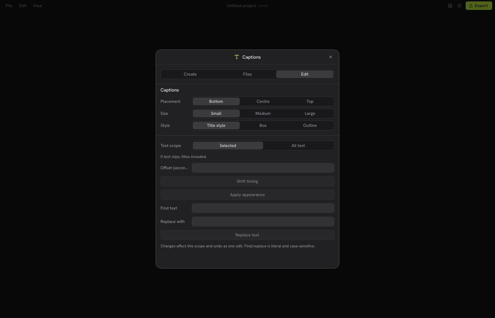

# VeyCut — وی‌کات


VeyCut is a native video editor with timeline editing, video effects, transitions, titles, captions and local speech tools. Product repository: https://github.com/alirezap73/veycut.

## Development changes

See the [editing milestone](docs/FEATURE-PROGRESS.md) for current capability work
and the checks required for the new source revision.

Development source is now **0.3.1**, with grouped copy/paste across timelines, a multi-selection duplicate shortcut, independent detached-audio movement, directly clickable track-placement choices and correct audio-meter labels. Paged caption navigation and full duplicated-group selection passed exact-source validation and packaged GUI checks on runtime `36e98b7`; the latest runtime has passed source validation and matching packaged GUI checks. The previously verified 0.3.0 package below does not contain these changes; matching validation and packaging are tracked separately. Public downloads remain unchanged. GitHub's file list shows the last commit that changed each file, so an old commit mentioning 0.1.0 is not the current app version. See the [version and commit policy](docs/VERSIONING.md).

Previously validated runtime (`36e98b7`) passed [796 native Rust test invocations, Linux lints/performance, macOS compilation and WebAssembly checks](https://github.com/alirezap73/veycut/actions/runs/38107827064). The same run passed 263 development invocations, including 31 rendering tests; all three caption-navigation tests passed in the native suite. This revision adds supported bitmap/COLR v0 colour glyphs, compact stereo/dB meter readouts, fitted still-image decoding and native dialogs that release editor borrows. The [matching package](https://github.com/alirezap73/veycut/actions/runs/38108844684) built successfully; its [55-step core GUI check](https://github.com/alirezap73/veycut/actions/runs/38115400994), [23-step caption-navigation check](https://github.com/alirezap73/veycut/actions/runs/38115397274) and [98-step extended check](https://github.com/alirezap73/veycut/actions/runs/38116397350) passed. These results do not establish full feature parity or an official beta. See [exact-source evidence and release gates](docs/BETA-READINESS.md).

The newest source also fixes clipped stereo meters in the initial/resized dock and propagates uncaptured GPU/device failures across compositor siblings. [Exact-source validation](https://github.com/alirezap73/veycut/actions/runs/38109658662) passed 801 Rust test invocations, including all four layout regressions and the real captured/uncaptured GPU-error regression. [Its matching candidate](https://github.com/alirezap73/veycut/actions/runs/38115406465) built successfully; [extended](https://github.com/alirezap73/veycut/actions/runs/38117957948), [core](https://github.com/alirezap73/veycut/actions/runs/38118020433) and [caption-navigation](https://github.com/alirezap73/veycut/actions/runs/38118025361) package checks passed (98, 55 and 23 actions respectively). The matching extended output fully decoded 32 seconds at 720×1280/30 fps, with 960 H.264 frames and stereo AAC. Default-layout screenshots show the 64-pixel meter pane with both channels fully visible and a held peak of −6 dB; clipping-reset interaction was not exercised. The earlier candidate above does not include these later changes.

The latest runtime (`974c65e`) additionally embeds a shared 2.74 MB CJK fallback for the UI and title renderer and exposes icon buttons with accessible roles and names. An earlier new-test compilation failure was corrected. [Full validation](https://github.com/alirezap73/veycut/actions/runs/38117995463) passed **806 Rust test invocations**, **0 failed**, with **1 ignored model/audio transcription test**. Quick checks passed **271 invocations** (**250 Rust + 21 Python**). All four CJK UI regressions and the mixed-script raster test passed, along with Linux lints/performance, gRPC checks, WebAssembly and macOS all-target compilation. The Mac job compiles targets rather than executing native tests. The [final candidate](https://github.com/alirezap73/veycut/actions/runs/38119080271) built successfully from package source `39cc82cebf1904c1b65f860d6fe674b0ca1aacd2`, which includes runtime `974c65e`. Matching [core](https://github.com/alirezap73/veycut/actions/runs/38121113154), [caption-navigation](https://github.com/alirezap73/veycut/actions/runs/38121118094) and [extended](https://github.com/alirezap73/veycut/actions/runs/38121124147) GUI checks passed **55**, **23** and **98** actions. The extended check observed the **AX Pause control**, then paused at **17.473 seconds** after native-panel cancellation and **24.967 seconds** after acceptance, meeting `4 <= paused < 32`. Its 32-second H.264/AAC output at 720×1280/30 fps, 960 frames and 48 kHz stereo fully decoded. This does not establish bare-Space focus restoration or timer updates during the held panel.

[Exact-package real-movie import/reopen](https://github.com/alirezap73/veycut/actions/runs/38121129800) also passed with a 596.46-second, 640×359 H.264/AAC movie. This is import/reopen only; the movie was not placed on the timeline, edited or exported. CJK UI/raster regressions passed in source validation; these packaged scenarios are not a separate CJK-text GUI proof.

The **69,563,828-byte** DMG SHA-256 is `2150c1b883449d1013a9e2d01a177b569795f4bc7244664d16bfd0b339829c1d`. `v0.3.1-beta.1` is staged as an **unpublished draft**; public downloads remain **0.2.0-preview.1**. An independent Mac/tester is available, but its actual installation and real-footage editing report is still pending. Common subset coverage and Simplified Chinese glyph-form limitations are documented in the font notice.

A light local check of the exact final package on the development Mac (macOS 27.0.1, arm64) verified its hash/signature, native import, split Undo/Redo with identical IDs/properties, bilingual captions, the unique edited text `Local beta check`, and exact save/close/reopen. A UI-driven two-second 720×1280/30 fps H.264/AAC export fully decoded (60 frames, 48 kHz stereo), with silence then tone in both channels; extracted frames confirmed Persian and the edited English text. The app was quit and the DMG unmounted. This used a generated fixture and CLI download: independent consumer installation, browser quarantine/Gatekeeper flow, separate-player viewing, long sessions and real-camera editing remain unverified. No local source build or model download was performed.

This development source adds selectable export resolutions without changing the editing project. Titles and captions are rasterized at the selected output size. Export files are isolated per job; the finished output refuses an existing file, including one created during rendering, and failed/cancelled jobs clean up their own work files. Cancelled jobs and replies from an earlier project cannot replace the current export status.

The shipping profile uses thin LTO. A build-speed improvement has not been established by a controlled comparison. The package cache now retains workspace crates under a new policy key; a candidate build completed with this policy, but a controlled speed comparison remains pending. Windows effect tests execute the exact previously compiled test binary, keeping compilation outside the GPU-test timeout. Missing first-start effect previews use placeholders while cards are being generated. New log headers and filenames use VeyCut.

Missing-media recovery runs in a cancellable background search. Duplicate filenames are left offline, symlinks are not followed and bounded or unreadable searches make no edits. See the [English/Persian quick start](docs/QUICK-START.md).

The previously verified development runtime (`e46372a`) makes duplication and paste one complete undoable edit, including the clip's styling and timing. It passed [775 native test invocations, macOS compilation and WebAssembly checks](https://github.com/alirezap73/veycut/actions/runs/38067689837) and [225 development test invocations](https://github.com/alirezap73/veycut/actions/runs/38067695299). Its [replacement Mac package](https://github.com/alirezap73/veycut/actions/runs/38069013402) passed a [55-step GUI scenario](https://github.com/alirezap73/veycut/actions/runs/38085438701): native import and timeline placement, split undo/redo, editable bilingual captions, text replacement, WebVTT export, save/reopen and video export. The independently decoded two-second output contains the edited subtitle, 60 video frames and the expected sound timing. The later runtime `36e98b7` extended check verified move/head-and-tail trim, grouped edits and native import-panel cancellation/acceptance during playback, then fully decoded a 32-second H.264/AAC export with 960 frames. It used repeated synthetic media and a screenshot-confirmed pointer coordinate for Pause; it does not establish accessible Pause controls or timer updates during the held panel. Independent installation, drag/drop and longer user footage still need checks for the [beta milestone](docs/BETA-READINESS.md). The candidate remains **unpublished**. The public download stays at **0.2.0-preview.1**; small releases use patch increments, and the development version will not increase for each commit.

## Core beta development

The next milestone is a reliable Apple silicon macOS beta covering media import, timeline edits, text/audio, save/reopen and export. The public preview stays at **0.2.0-preview.1**; the development candidate remains unpublished and its version is fixed. See [verified scope and remaining beta gates](docs/BETA-READINESS.md), the [small sample and manual editing check](docs/BETA-TEST.md), and the beta bug form in Issues. Development source is on [development/0.3.0](https://github.com/alirezap73/veycut/tree/development/0.3.0).

## Browser prototype

The new [Web prototype](web/README.md) develops alongside the Mac beta, with local video import/preview, trim/split, Undo/Redo, project JSON save/reopen and bilingual SRT editing. A portable WebAssembly bridge uses the shared project engine; browser decoding and local media connections stay in JavaScript. The VeyCut Web workflow builds the static package and checks actual browser editing on a GitHub runner. The prototype now implements bounded real-time **WebM video export with source audio and burned subtitles**, cancellation and black/silent timeline gaps. It supports up to 120 seconds, a 960-pixel long edge and 64 MiB of output; timing can drift under load. The new export/decode tests run on GitHub and their results are tracked separately from the earlier editing checks. No external model service or hosted public editor is available yet. Browser compatibility and longer editing sessions remain to be verified. The Mac package and app version do not change for this work.

## Version 0.2.0 changes

- **Caption workspace:** separate Create, Files and Edit tabs, with a scrolling dialog for smaller windows.
- **Subtitle interchange:** import SRT and plain-text WebVTT; export either format from selected text clips or the whole timeline. Titles are included explicitly in the scope count.
- **Timing correction:** shift selected or all text clips by signed seconds in one undo step. Invalid times and collisions on the same track are rejected before changing anything.
- **Group appearance:** apply placement, size, boxed or outlined appearance to existing text clips, preserving each clip's font and content.
- **Find and replace:** literal, case-sensitive UTF-8 replacement over the chosen text scope, with one undo step and validation before editing.
- **Persian font:** Vazirmatn is embedded in the editor and title renderer. New Persian captions without a chosen title font use it automatically. Boxed and outlined Persian presets are included. The variable font is rendered at its default weight.
- **Quick project formats:** portrait 1080×1920 or 720×1280, square 1080×1080 and landscape 1920×1080, at 30 fps; existing custom controls remain available.
- **Reliable operations:** cancellation invalidates old subtitle/transcription replies; subtitle reads are bounded and writes are atomic. Video export validates filenames and refuses an existing output at preflight. GPU completion/readback waits have a 30-second limit.
- **Verification artifacts:** server tests exercise real Slint forms at desktop and phone sizes, bundled Persian shaping without system fonts, and a bilingual 720p/30 fps export with audio and full decoding.

## Preview and verification

The Apple silicon macOS preview is available from [GitHub Releases](https://github.com/alirezap73/veycut/releases/tag/v0.2.0-preview.1). Choose the `VeyCut-0.2.0-macos-arm64.dmg` asset. Intel Macs, Windows, Linux and mobile installers are not included in this preview.

The interface supports English and Persian. Change it in **Settings → Language**. To try the new subtitle tools, open **Captions → Files** and import an SRT or plain-text WebVTT file; **Edit** provides group timing, appearance and literal find/replace operations. Try the [bilingual subtitle examples](docs/caption-examples/TRY-CAPTIONS.txt).



The built DMG passed [package inspection on macOS 15](https://github.com/alirezap73/veycut/actions/runs/38027085464): image verification, strict signature verification, library path checks, and a 30-second startup with a native VeyCut window observed. First startup generates effect thumbnails and may log missing-thumbnail messages while they are being created.

This is an experimental preview. The macOS app is ad-hoc signed and is not Apple-notarized. Installation on a separate clean machine, drag-and-drop flows and long editing sessions remain unverified. Development candidate GUI evidence does not establish these checks for the older public installer.

The unchanged runtime source passed **748 Linux native test cases**, macOS compilation and wasm checks. The release candidate also passed **198 development checks**. Server checks cover actual Slint form rendering and caption pointer/reopen behavior, bundled Persian font shaping, and a bilingual 720×1280/30 fps video export with audio and full decoding. See [native validation](https://github.com/alirezap73/veycut/actions/runs/38021310768) and [Mac candidate validation](https://github.com/alirezap73/veycut/actions/runs/38024725413). The baseline run includes a Windows timeout; it is not an all-platform pass. [Windows validation](https://github.com/alirezap73/veycut/actions/runs/38024989783) is tracked separately.

`manifest.json` records the package source revision, file size and checksum. `VALIDATION.json` records the native validation revision and permitted workflow/documentation differences. `PACKAGE-INSPECTION.json` records the startup check. `SHA256SUMS` covers the package and all three metadata files. See [the release checklist](FORK-RELEASE.md).

## Build and test

Rust 1.93 and the native dependencies documented in [src/README.md](src/README.md) are required. For a small local check:

```sh
cd src
cargo test --locked -j 1 -p concat-core -p concat-project -- --test-threads=1
cargo fmt --all --check
cargo clippy --locked -j 1 -p concat-project --all-targets -- -D warnings
```

Use GitHub Actions for full native validation and packaging on machines where a large local build is undesirable.

## Subtitle files

Files must be UTF-8 and at most 1 MiB. Timestamps are supported through 99:59:59,999. Cue duration must be at least 1/60 second. Overlaps and multiline text are preserved. Inline cue markup remains literal text; WebVTT export escapes it. WebVTT accepts a header, comments, cue identifiers and short/full timestamps; CSS, regions and cue layout settings are rejected explicitly. Subtitle files carry timing and text, not fonts or appearance. Export and find/replace reject blank separator lines inside a caption.

## License

AGPL-3.0-or-later. Original copyright and third-party notices are retained. See [LICENSE](LICENSE), [source notices](SOURCE-NOTICES.md), [additional permissions](LICENSE-EXCEPTIONS.md) and [trademark notices](TRADEMARK.md). Desktop bundles include the licenses for all embedded fonts.
